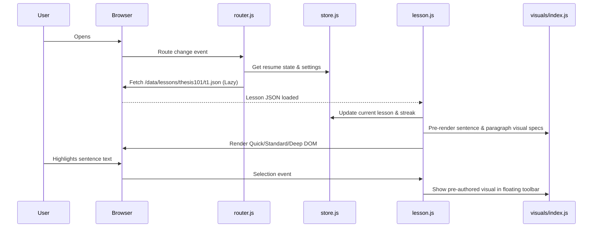

# Quick Services Academy — System Architecture

## 1. Architectural Philosophy
Quick Services Academy is engineered as a **100% static, client-side web application** hosted on Cloudflare Pages.
- **Zero Build Step**: No webpack, no Vite, no node build pipeline required for deployment. Edit static files, commit, and deploy instantly.
- **Zero Heavy Frameworks**: Pure HTML5, modern CSS with Custom Properties, and modular vanilla JavaScript (ES modules).
- **Zero Blocking Dependencies**: The only external asset loaded over the network is Google Fonts (`Bricolage Grotesque` and `Plus Jakarta Sans`). If the network is offline or fonts fail, clean system font fallbacks ensure 100% legibility and functionality.
- **Zero Telemetry or Invasive Trackers**: No third-party ad scripts, tracking pixels, or data harvesting.

---

## 2. Directory Layout & Module Structure

```
/index.html                    app shell and mount points
/css/
  ├── tokens.css               CSS custom properties (colors, typography, radii, spacing)
  ├── base.css                 Reset, global typography, container wrappers, accessibility focus
  ├── components.css           Cards, buttons, chips, tabs, dialogs, drawers, bottom sheets, toasts
  ├── visuals.css              Styling rules for the 30+ visual kinds (SVG graphs, matrices, funnels)
  └── quiz.css                 Interactive question layout, feedback badges, drag targets
/js/
  ├── app.js                   Application bootstrapper, global event coordinator, theme listener
  ├── router.js                Hash-based client router (#/, #course-id, #lesson-course-id)
  ├── store.js                 State manager, local progress persistence (qsa-progress-v2)
  ├── lesson.js                Reader engine, depth switcher, margin rail, floating selection toolbar
  ├── certificate.js           Canvas PNG generator, print formatter, verification hash builder
  ├── visuals/
  │   └── index.js             Renderer factory for 30+ semantic SVG/HTML visual components
  ├── quiz/
  │   └── index.js             Unified quiz engine handling all 12 question modalities
  └── widgets/
      └── index.js             15 standalone interactive calculators and academic widgets
/data/
  ├── courses.json             Master catalog summaries and metadata
  ├── paths.json               Curated learning paths
  ├── courses/                 Individual course curriculum manifests (<id>.json)
  └── lessons/                 Lazy-loaded individual lesson files (<course>/<id>.json)
/videos/
  └── tracker.csv              Video production tracking ledger
/video-scripts/                Word-for-word scripts and shot lists (<vid>.md)
/assets/
  └── samples/                 Fictional sample datasets and templates for exercises
/theme/
  ├── tokens.json              Machine-readable design tokens
  └── NOTES.md                 Extracted design notes and screenshots reference
/tools/
  └── validate-content.mjs     Automated pedagogical content and schema linter
/docs/
  ├── EXPERIENCE_REFERENCE.md  Reference study of Anthropic Skilljar & modern platforms
  ├── DESIGN_SYSTEM.md         Formal token, component, and accessibility specifications
  ├── CURRICULUM.md            Master curriculum map for all 9 courses and 168 lessons
  ├── SCHEMA.md                JSON schema documentation for lessons, visuals, and quizzes
  ├── STYLE_GUIDE.md           Editorial standards, ESL reading guidelines, and integrity rules
  ├── ARCHITECTURE.md          System architecture and client lifecycle
  ├── SOURCES.md               Primary sources and official regulatory references
  ├── OPEN_QUESTIONS.md        Open design queries and policy benchmarks
  ├── VIDEO_GUIDE.md           Video production and embedding instructions
  ├── ASSISTANT_OPTION.md      Blueprint for server-side AI study assistant integration
  ├── SYNC_OPTION.md           Blueprint for cross-device progress synchronization
  ├── CERTIFICATE_VERIFICATION.md Certificate verification protocol and registry options
  ├── DEPLOY.md                Cloudflare Pages static deployment guide
  └── QA_REPORT.md             Comprehensive quality assurance audit report
```

---

## 3. Data Flow & Execution Lifecycle


