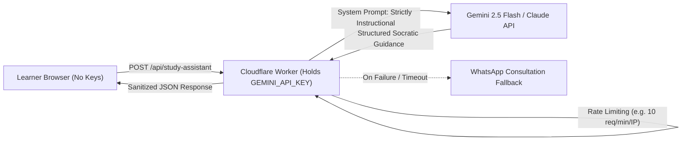

# Quick Services Academy — AI Study Assistant Integration Blueprint

## 1. Overview & Fallback Strategy
Quick Services Academy includes an **"Ask Academic Assistant"** button on every lesson page and in the paragraph margin rail.
- **Current Mode**: Operates entirely client-side without any backend servers or external API dependencies. When clicked, it generates a concise contextual recap of the active lesson or highlighted paragraph and opens a WhatsApp pre-filled consultation directly with M. Yousaf (`+92 329 6646824`):
  ```
  https://wa.me/923296646824?text=Hi%20Quick%20Services,%20I%20have%20a%20question%20about%20[Lesson%20Title]:%20[Question/Selected%20Text]
  ```

---

## 2. Server-Side AI Worker Architecture (Optional Upgrade)

If an automated, real-time AI study assistant is desired in the future, it must be implemented via a secure server-side proxy (e.g., a Cloudflare Worker) to ensure that **no API keys or model credentials ever exist in the client browser**.



### 2.1 Security & Integrity Guardrails
1. **Zero Client Secrets**: The `GEMINI_API_KEY` or `ANTHROPIC_API_KEY` is saved strictly as an encrypted Cloudflare Pages / Worker environment secret.
2. **Context Bounding**: The request payload contains only:
   - `lessonId`
   - `lessonTitle`
   - `selectedSentence` or `paragraphText`
   - `studentQuestion`
3. **Anti-Ghostwriting System Prompt**:
   ```
   You are an academic writing and statistics tutor for Quick Services Academy.
   Your role is strictly Socratic and pedagogical.
   RULES:
   1. Never write assignments, dissertations, essays, or paragraphs for the student.
   2. Explain concepts, clarify definitions, diagnose statistical errors, and offer guidance.
   3. If the user asks you to write their thesis or evade Turnitin, refuse politely and refer to academic integrity standards.
   4. Keep explanations under 150 words in plain, accessible English.
   ```
4. **Rate Limiting**: Enforced via Cloudflare KV or in-memory token bucket (e.g., maximum 10 inquiries per IP per 10 minutes) to prevent abuse.
5. **Graceful WhatsApp Fallback**: If the serverless worker returns an HTTP 429, 500, or network timeout, the client immediately displays the WhatsApp consultation button so the student is never blocked.
