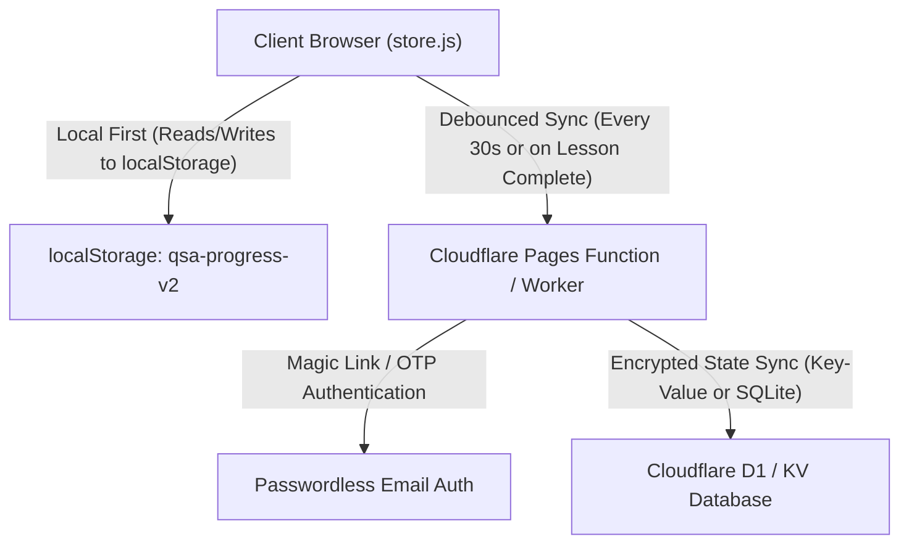

# Quick Services Academy — Cross-Device Cloud Sync Blueprint

## 1. Current Storage Model
Quick Services Academy saves 100% of learner state locally in the user's browser using `localStorage` under the versioned key `qsa-progress-v2`.
- Zero account registration required.
- Zero tracking or user surveillance.
- Resilient try/catch wrappers guarantee seamless site operation even in private browsing or when storage cookies are blocked.
- Built-in **Export Progress (JSON)** and **Import Progress (JSON)** buttons empower students to manually back up their notes, bookmarks, streaks, and quiz results or transfer them to another device.

---

## 2. Serverless Cloud Sync Architecture (Optional Upgrade)

If seamless automatic cross-device synchronization (e.g. studying on a laptop at university and continuing on a mobile phone at home) is desired in the future, it can be added without disrupting the offline-first static foundation.



### 2.1 Technical Specifications
1. **Passwordless Magic Link Authentication**: Students enter their email to receive a secure 6-digit one-time code or magic login link, eliminating passwords.
2. **Conflict Resolution (Last-Write-Wins with Merge)**:
   - Numerical timestamps accompany each lesson completion, note, and quiz score.
   - When synchronizing between two devices, union operations merge completed lesson sets, while higher quiz scores and newer notes take precedence.
3. **Database Schema (Cloudflare D1 / SQLite)**:
   ```sql
   CREATE TABLE users (
     id TEXT PRIMARY KEY,
     email TEXT UNIQUE NOT NULL,
     created_at INTEGER NOT NULL
   );

   CREATE TABLE progress_snapshots (
     user_id TEXT NOT NULL,
     payload_json TEXT NOT NULL,
     updated_at INTEGER NOT NULL,
     FOREIGN KEY (user_id) REFERENCES users(id)
   );
   ```
4. **Privacy Guarantee**: All notes and progress data remain private to the student and are never sold or shared.
