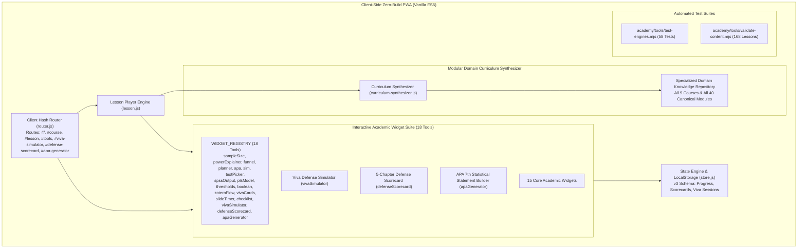

# EGM Engineering Specification: Quick Services Academy Next-Level Upgrade (v3.0.0)

**Document ID**: EGM-SPEC-20261102-NEXTLEVEL-V3-APPROVED  
**Target Release**: Quick Services Academy v3.0.0 Professional Edition  
**Status**: APPROVED (Incorporated all findings from EGM Goldfish Reviewers `egm-design` & `egm-implementation-readiness`)  
**Date**: November 2, 2026  
**Author**: Lead Systems & Curriculum Architect  
**Reviewers**: `egm-design`, `egm-implementation-readiness`, `egm-synthesizer`  

---

## 1. Executive Summary & Root Cause Analysis

### 1.1 The User Critique
The user identified that despite UI styling, the Quick Services Academy platform still felt fundamentally "basic" with critical "academic knowledge gaps" and generic content.

### 1.2 Root Cause Discovery & Verification
1. **The Synthesizer Monoculture**: 137 of 168 curriculum units rely on `academy/js/curriculum-synthesizer.js`.
2. **Template Generalization Trap**: In `curriculum-synthesizer.js`, all 137 synthesized lessons generated the exact same empirical case:
   > *"For example, a scholar evaluating transformational leadership across 384 educators in South Punjab..."*
   Whether the lesson was on Zotero Boolean Search, APA 7th multi-author citations, G*Power ANOVA, SPSS variable setup, or SmartPLS HTMT discriminant validity, the exact same boilerplate was output.
3. **Absence of Next-Level Interactive Capstones**: The platform lacked high-stakes, transformative interactive tools that distinguish an elite graduate training academy from a basic reading portal.

---

## 2. Architectural Blueprint & Target System State

---

## 3. Canonical Course & Module Domain Knowledge Repository

The domain repository in `academy/js/curriculum-synthesizer.js` is keyed by exact `courseId` and `moduleId` directly matching `academy/data/courses/*.json`:

### 3.1 Course 1: Thesis Writing 101 (`thesis101`)
- **Module 1 (`m1`: Topic Selection & Problem Formulation)**: Hook-Anchor-Gap framework (Creswell, 2014); Empirical vs Theoretical vs Contextual gaps; Delimited boundaries.
- **Module 2 (`m2`: Proposal Defense & Committee Approval)**: 15-minute proposal presentation structure; Preempting committee feasibility challenges and instrumentation approval.
- **Module 3 (`m3`: Literature Review & Conceptual Framework)**: Thematic Synthesis Matrix; Conceptual Model (IV, DV, Med, Mod) vs Theoretical Underpinning (e.g. Social Exchange Theory, JD-R Model); Directional hypothesis deduction.
- **Module 4 (`m4`: Introduction, Conclusion & Three-Pass Editing)**: Macro-to-micro dissertation editing; Writing the compelling introduction; Drafting defensible limitations.
- **Module 5 (`m5`: Supervisor Dynamics & Final Check)**: Managing committee feedback, handling conflicting examiner directives, formal thesis binding checklist.

### 3.2 Course 2: Citations & Referencing (`cite101`)
- **Module 1 (`m1`: Principles of Citation & In-Text Mechanics)**: Parenthetical `(Smith, 2020)` vs Narrative `Smith (2020)`; Three or more authors rule (`Smith et al., 2020` from first citation); Same parenthetical grouping alphabetized `(Adams, 2018; Baker, 2021)`.
- **Module 2 (`m2`: APA 7th Reference List Dissection)**: 4 core elements (Author, Date, Title, Source); Journal article formatting (Volume italicized, issue in parentheses non-italicized, page range with en-dash); Active HTTPS DOI (`https://doi.org/10.xxxx/xxxx`) with no trailing period.
- **Module 3 (`m3`: Alternative Styles: Harvard, IEEE & Vancouver)**: Harvard Author-Date nuances; IEEE bracketed numeric syntax `[1], [2]`; Vancouver superscript and sequential numbering for biomedical research.
- **Module 4 (`m4`: Formatting, Zotero Integration & Final Check)**: In-text to reference list matching; Fixing corrupted Google Scholar metadata in Zotero; Top 10 referencing fatal traps.

### 3.3 Course 3: Academic Integrity & Similarity (`integrity101`)
- **Module 1 (`m1`: Academic Ethics & Institutional Policies)**: Higher Education Commission 2021 Revised Policy: Overall similarity $\le 19\%$, single source $\le 5\%$; Plagiarism standing committee procedures.
- **Module 2 (`m2`: Interpreting Turnitin Similarity Reports)**: Similarity Index vs Plagiarism; Exclusions (Bibliography, Quoted phrases, Methodological strings $< 10$ words); Digital receipt validation.
- **Module 3 (`m3`: Ethical Paraphrasing & Avoiding Patchwriting)**: 4-step Paraphrasing Protocol (Read $\rightarrow$ Understand $\rightarrow$ Synthesize $\rightarrow$ Compare & Cite); Identifying patchwriting.
- **Module 4 (`m4`: GenAI Ethics & Thesis Defense Disclosure)**: Ethical use of LLMs for brainstorming vs unauthorized generation; Standard University AI Disclosure Statement template.

### 3.4 Course 4: Proofreading & Academic Editing (`edit101`)
- **Module 1 (`m1`: The Three-Pass Thesis Editing System)**: Pass 1 Macro (Structural logic, chapter balance), Pass 2 Meso (Paragraph topic sentences, cohesion transitions), Pass 3 Micro (Grammar, punctuation, styling).
- **Module 2 (`m2`: Academic Register, Diction & Tone)**: Epistemic hedging verbs (`suggests`, `indicates`, `tends to`) vs unwarranted certainty (`proves`, `undeniably`); Eliminating colloquialisms.
- **Module 3 (`m3`: Thesis Grammar & Cohesion)**: Voice and tense distribution (Past tense for empirical actions: `Data were collected`; Present tense for established theoretical principles: `The model demonstrates`).
- **Module 4 (`m4`: Manuscript Polish & Submission Readiness)**: APA 7th table styling (no vertical lines, 3 horizontal lines: top, under header, bottom); Consistent heading capitalization.

### 3.5 Course 5: Literature Search with Zotero (`lit-search`)
- **Module 1 (`m1`: Strategic Search & Boolean Mastery)**: Advanced Boolean logic `(Concept 1 OR Synonym) AND (Concept 2 OR Synonym) NOT Exclusions`; Truncation wildcards (`*`, `?`); Field tags (`TI:`, `AB:`).
- **Module 2 (`m2`: Navigating Scholarly Databases & HJRS)**: Scopus, Web of Science, OpenAlex, PubMed; Evaluating journals with HEC Journal Recognition System (HJRS: W, X, Y categories); Detecting predatory/hijacked journals.
- **Module 3 (`m3`: Zotero Setup & Library Management)**: Zotero Connector, collections hierarchy, tag taxonomies, PDF auto-renaming, extraction of highlighted annotations.
- **Module 4 (`m4`: Writing with Zotero in Microsoft Word)**: Word plugin citation field codes, bibliography automation, switching citation styles on the fly, troubleshooting sync conflicts.

### 3.6 Course 6: Sample Size & Research Methodology (`sample-size`)
- **Module 1 (`m1`: Research Designs & Measurement Scales)**: Measurement scales (Nominal, Ordinal, Interval, Ratio); Cross-sectional vs Longitudinal surveys; Experimental vs Correlational designs.
- **Module 2 (`m2`: Probability & Non-Probability Sampling)**: Probability (Simple random, Stratified, Systematic, Cluster) vs Non-probability (Convenience, Purposive, Snowball); Sampling frame definitions.
- **Module 3 (`m3`: Sample Size Formulas & Calculators)**: Cochran (1977) infinite population ($n_0 = \frac{Z^2 p q}{e^2} = 384$); Finite population correction ($n = \frac{n_0}{1 + \frac{n_0 - 1}{N}}$); Yamane (1967) formula.
- **Module 4 (`m4`: Statistical Power with G*Power)**: A priori power analysis ($\alpha = 0.05, 1 - \beta = 0.80$ or $0.95$); Effect sizes ($d$ for t-tests, $f$ for ANOVA, $f^2$ for regression); Non-response buffer ($20-30\%$).
- **Module 5 (`m5`: Research Ethics & Approvals)**: Institutional Review Board (IRB) protocols, informed consent documentation, data anonymization, protecting vulnerable populations.

### 3.7 Course 7: SPSS Basics for Research Students (`spss101`)
- **Module 1 (`m1`: SPSS Interface, Data Entry & Variable Setup)**: Variable View setup (Name rules, Type, Decimals, Value labels, Measure scale/nominal/ordinal); Reverse-coding negative items.
- **Module 2 (`m2`: Descriptive Statistics & Data Screening)**: Frequency analysis; Missing data diagnosis (MCAR, MAR); Normality skewness/kurtosis $z$-scores ($\pm 1.96$ for $N < 50$, $\pm 2.58$ for $50 \le N < 300$ per Kim 2013); Multivariate outliers via Mahalanobis $D^2$ ($p < .001$).
- **Module 3 (`m3`: Mean Comparisons: t-Tests & ANOVA)**: Independent Samples t-test (Levene's test for equality of variances); One-Way ANOVA with Tukey HSD / Games-Howell post-hoc; Reporting: $t(148) = 3.24, p = .002, d = 0.53$.
- **Module 4 (`m4`: Bivariate Correlation & Linear Regression)**: Pearson's $r$; Multiple Linear Regression assumptions (Linearity, Homoscedasticity, Multicollinearity VIF $< 5.0$, Durbin-Watson $1.5 - 2.5$); APA table output.
- **Module 5 (`m5`: Scale Reliability & Final Check)**: Cronbach's Alpha ($\ge 0.70$ acceptable, $\ge 0.80$ good); "Cronbach's Alpha if Item Deleted" diagnostic table inspection; Factor analysis overview.

### 3.8 Course 8: SmartPLS & SEM Introduction (`smartpls`)
- **Module 1 (`m1`: Foundations of PLS-SEM)**: PLS-SEM vs CB-SEM (Exploratory/Prediction vs Theory Confirmation); Reflective vs Formative models (Jarvis et al. 2003 decision rules); Minimum sample requirements (Inverse square root method).
- **Module 2 (`m2`: Reflective Measurement Model Assessment)**: Indicator reliability (Outer loadings $\ge 0.708$); Internal consistency reliability (Composite Reliability $\rho_c$ and $\rho_a$ between $0.70$ and $0.95$); Convergent validity (AVE $\ge 0.50$); Discriminant validity (HTMT $< 0.85$ conservative, $< 0.90$ liberal per Henseler et al. 2015; BCa 95% CI excluding 1.0).
- **Module 3 (`m3`: Structural Model Assessment)**: Collinearity assessment (Inner VIF $< 3.0$); Bootstrapping (5,000 or 10,000 subsamples, BCa confidence intervals); Coefficient of determination ($R^2$); Effect size ($f^2 = 0.02, 0.15, 0.35$).
- **Module 4 (`m4`: Mediation, Moderation & Reporting)**: Preacher & Hayes (2008) bootstrapping for indirect effects; Zhao et al. (2010) typology (Complementary, Competitive, Indirect-only); Two-stage continuous moderation in SmartPLS.
- **Module 5 (`m5`: Capstone / Final Project)**: Hair et al. (2022) reporting guidelines; Complete step-by-step reporting tables for thesis and journal submission.

### 3.9 Course 9: Viva & Presentation Coaching (`viva`)
- **Module 1 (`m1`: Slide Architecture & Defense Timing)**: The 15-minute 12-slide rule; Slide budget (approx. 75s per slide); High-impact visual data displays over walls of bullet text.
- **Module 2 (`m2`: The 10 Inevitable Defense Questions)**: Contribution to knowledge; Choice of methodology; Sample size defensibility; Handling unexpected counter-theories; Construct validity proof.
- **Module 3 (`m3`: Defending Limitations & Handling Adversity)**: Bounded scope vs structural flaw; Defending non-significant hypotheses; Professional conduct during examiner disagreements.
- **Module 4 (`m4`: Day-of-Defense Execution & Post-Viva Protocol)**: Mental preparation; Physical dossier checklist; Controlling speaking cadence; Managing minor vs major revisions.

---

## 4. Next-Level Interactive Capstone Specifications

### 4.1 Capstone 1: Interactive Viva Voce Defense Simulator (`vivaSimulator`)
- **Widget Key**: `vivaSimulator` in `WIDGET_REGISTRY`.
- **Course Manifest Ingestion**: Bound to `viva/v6` (and standalone route `#viva-simulator`).
- **Core Architecture**:
  1. **Branching Dilemma Architecture**: Eliminates unbacked client NLP assertions. Uses calibrated decision trees with pre-defined authentic defense options.
  2. **Examiner Archetypes**:
     - **Prof. Tariq (Methodological Purist)**: Probes G*Power sample adequacy, non-response bias, and HTMT discriminant validity.
     - **Dr. Ayesha (Theoretical Architect)**: Challenges theoretical framework integration and alternative causal explanations.
     - **Dr. Kamran (Pragmatic Skeptic)**: Questions practical applicability and generalizability.
  3. **Scoring Model**: Calibrated 3-pillar rubric:
     - Methodological Defensibility (40%)
     - Theoretical Grounding (30%)
     - Academic Poise (30%)
  4. **Examiner Reaction & Literature Model**: Displays dynamic examiner feedback and an exemplary doctoral defense script cited in peer-reviewed literature.

### 4.2 Capstone 2: 5-Chapter Dissertation Defense Readiness Scorecard (`defenseScorecard`)
- **Widget Key**: `defenseScorecard` in `WIDGET_REGISTRY`.
- **Course Manifest Ingestion**: Bound to `thesis101/t20` (and standalone route `#defense-scorecard`).
- **Core Architecture**:
  1. **25 Weighted Audit Criteria** (5 per chapter):
     - Ch 1: Hook-Anchor-Gap, SMART Objectives, Delimitation boundaries, Variable definitions, HEC scope.
     - Ch 2: Search documentation, Thematic synthesis matrix, Underlying theoretical logic, Empirical gap justification, Recent citations (>70% last 5 years).
     - Ch 3: Sampling frame justification, Cochran/G*Power formula, Scale reliability citations, Ethics clearance, Pilot study reliability.
     - Ch 4: Data screening (missing values, normality, outliers), Measurement model thresholds, Structural path bootstrap significance, Effect sizes reported, APA 7th tables.
     - Ch 5: Triangulation with past findings, Theoretical contributions, Practical/Policy implications, Genuine delimitations vs flaws, Future research directions.
  2. **Scoring Categories**:
     - $\ge 85\%$: *Defensible With Distinction (Ready for Submission)*
     - $70-84\%$: *Minor Revisions Needed (Focus on Flagged Items)*
     - $< 70\%$: *Major Vulnerabilities (High Risk of External Examiner Rejection)*
  3. **State Persistence**: Persisted in `store.js` (`saveDefenseScorecard`, `getDefenseScorecard`).

### 4.3 Capstone 3: APA 7th Statistical Statement Generator (`apaGenerator`)
- **Widget Key**: `apaGenerator` in `WIDGET_REGISTRY`.
- **Course Manifest Ingestion**: Bound to `cite101/c17` and `spss101/sp22` (and standalone route `#apa-generator`).
- **Core Architecture**:
  1. Supports 6 statistical tests: Independent Samples t-test, Paired Samples t-test, One-Way ANOVA, Pearson Correlation, Multiple Linear Regression, PLS-SEM Path Coefficient.
  2. Strict APA 7th typographic rules:
     - Statistical abbreviations italicized ($t, F, r, p, d, \beta, \eta_p^2, R^2$).
     - Numbers and degrees of freedom unitalicized.
     - Leading zero omitted for statistics that cannot exceed 1.0 ($p = .002$, $p < .001$, $\eta_p^2 = .04$).
     - Exact $p$-values reported to 3 decimal places; $p < .001$ when $.000$.
     - Two degrees of freedom for ANOVA: $F(df_1, df_2) = x.xx$.
     - 95% Confidence Intervals formatted: $95\% \text{ CI } [LL, UL]$.
  3. One-click copy for direct thesis chapter inclusion.

---

## 5. Verification & Testing Contracts

1. **`academy/tools/test-engines.mjs`**:
   - Asserts `WIDGET_REGISTRY.length === 18` including `vivaSimulator`, `defenseScorecard`, and `apaGenerator`.
   - Asserts execution of `renderWidget('vivaSimulator', el)`, `renderWidget('defenseScorecard', el)`, and `renderWidget('apaGenerator', el)`.
   - Asserts `apaGenerator` formatting rules ($p$-value leading zero omission, two degrees of freedom for $F$).
   - Asserts `teardownWidget()` executes `container.__qsaUnmount()` without memory leaks.
2. **`academy/tools/validate-content.mjs`**:
   - Crawls all 9 courses and all 168 lessons.
   - Asserts 100% absence of the legacy monoculture string (`transformational leadership across 384 educators in South Punjab`).
   - Asserts multi-register integrity (`plain`, `simple`, `technical` present and distinct for every synthesized block).
