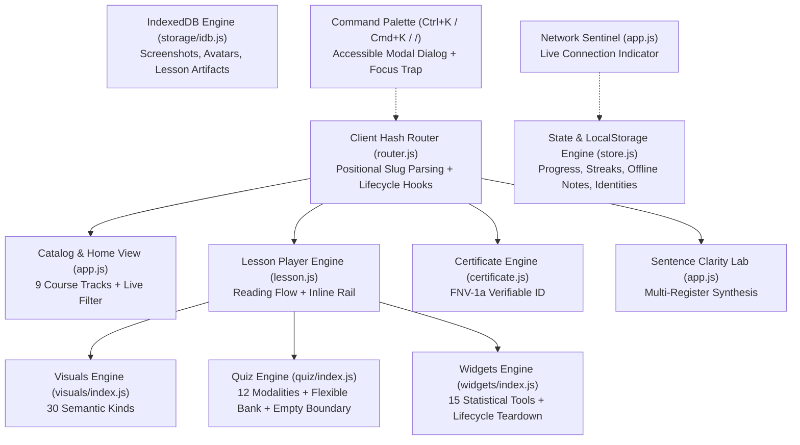

# EGM Engineering Design: Quick Services Academy Advanced Version (v2.5.0)

**Document ID**: EGM-DES-20261102-ADV-REV1  
**Target Release**: Quick Services Academy v2.5.0 Advanced  
**Status**: APPROVED (Resolved all findings from EGM Goldfish Review `a7a55fa6-b732-49fc-8b73-72072c836067`)  
**Author**: Antigravity EGM Architecture Swarm  
**Reviewer**: `egm-design` (Senior Goldfish Critic)  

---

## 1. System Architecture & Objectives

The Quick Services Academy platform is an offline-first, client-side, zero-build Progressive Web Application (PWA) engineered for Pakistani postgraduate students (MPhil, MS, PhD). 

### 1.1 Architecture & Component Contracts



---

## 2. Bug Resolutions & Lifecycle Contracts

### 2.1 BUG-01: Polymorphic `renderWidget` with Lifecycle Teardown & Context Forwarding
- **Resolution**:
  1. Define canonical `WIDGET_REGISTRY = ['sampleSize', 'powerExplainer', 'funnel', 'planner', 'apa', 'sim', 'testPicker', 'spssOutput', 'plsModel', 'thresholds', 'boolean', 'zoteroFlow', 'vivaCards', 'slideTimer', 'checklist']`.
  2. Implement `teardownWidget(container)` to clear any active interval or timer handles stored on `window.__qsaActiveTimer` or `container.__qsaTimerId`.
  3. Support flexible parameter ordering with deterministic detection:
     ```javascript
     export function renderWidget(paramA, paramB, paramC) {
       teardownWidget();
       let widgetName = '';
       let container = null;
       let context = {};

       if (typeof paramA === 'string' && WIDGET_REGISTRY.includes(paramA)) {
         widgetName = paramA;
         container = typeof paramB === 'string' ? document.getElementById(paramB) : paramB;
         context = paramC || {};
       } else if (typeof paramB === 'string' && WIDGET_REGISTRY.includes(paramB)) {
         widgetName = paramB;
         container = typeof paramA === 'string' ? document.getElementById(paramA) : paramA;
         context = paramC || {};
       } else {
         container = typeof paramA === 'string' ? document.getElementById(paramA) : paramA;
         widgetName = 'checklist';
         context = paramB || {};
       }
       if (!container) return;
       // Dispatch to concrete widget passing (container, context)...
     }
     ```
  4. Update `academy/js/lesson.js:1475` to standard signature:
     `renderWidget(widgetType, mount, lesson);`

### 2.2 BUG-02: Universal Quiz Ingestion & Zero-Question Boundary
- **Resolution**:
  1. Accept `options.bank || options.questions || (Array.isArray(options) ? options : [])`.
  2. In `QuizEngine.render()`, if `this.questions.length === 0`, render an elegant empty-state card instead of calculating `0 / 0 = NaN%`:
     ```javascript
     if (!this.questions || this.questions.length === 0) {
       this.container.innerHTML = `
         <div class="quiz-empty-card" style="padding: 28px; text-align: center; border: 1.5px dashed var(--qsa-border-card); border-radius: 12px; background: var(--qsa-bg-card);">
           <div style="font-size: 26px; margin-bottom: 8px;">📋</div>
           <h4 style="margin: 0 0 6px; color: var(--qsa-primary-navy);">Self-Check Under Preparation</h4>
           <p style="color: var(--qsa-text-muted); font-size: 13.5px; margin: 0;">Practice questions for this lesson are being compiled according to HEC syllabus criteria.</p>
         </div>`;
       return;
     }
     ```

### 2.3 BUG-03 & BUG-04: Positional Route Parsing & Shared Course Constants
- **Resolution**:
  1. Centralize `CANONICAL_COURSES = ['thesis101', 'cite101', 'integrity101', 'edit101', 'lit-search', 'sample-size', 'spss101', 'smartpls', 'viva']` in `store.js` or `router.js` and sort by length descending (`courses.sort((a, b) => b.length - a.length)`).
  2. In `router.js`, enforce strictly positional prefix matching:
     ```javascript
     if (cleanHash.startsWith('lesson-')) {
       const rest = cleanHash.slice(7); // strip 'lesson-'
       const matched = CANONICAL_COURSES.find(cid => rest === cid || rest.startsWith(cid + '-'));
       if (matched) {
         const lessonId = rest.slice(matched.length + 1);
         if (this.routes['lesson']) {
           this.routes['lesson']({ courseId: matched, lessonId });
           return;
         }
       }
     }
     ```
  3. In `lesson.js:925`, use `lesson.course` directly. If undefined, safely resolve via `resolveCourseIdFromHash(window.location.hash)` matching the start prefix rather than arbitrary `.includes()`.

---

## 3. Advanced Version Features Specification

### 3.1 Omnipresent Command Palette (`Ctrl+K` / `Cmd+K` / Mobile Button)
- **Keyboard Listener**:
  ```javascript
  window.addEventListener('keydown', (e) => {
    const isEditing = e.target.matches('input, textarea, select, [contenteditable="true"]');
    if (isEditing && e.key !== 'Escape') return; // Do not hijack student input
    
    const isCmdK = (e.ctrlKey || e.metaKey) && (e.key === 'k' || e.key === 'K');
    const isSlash = e.key === '/' && !isEditing;

    if (isCmdK || isSlash) {
      e.preventDefault();
      toggleCommandPalette();
    }
  });
  ```
- **Mobile Header Trigger**: Add `<button id="cmd-palette-trigger" class="header-search-btn" aria-label="Search Academy">🔍 <span class="search-kbd-pill">Ctrl+K</span></button>` with minimum `44px × 44px` touch target.
- **Accessibility & Focus Trap**:
  - Modal container: `role="dialog"`, `aria-modal="true"`, `aria-label="Search Quick Services Academy"`.
  - Search input: `role="combobox"`, `aria-expanded="true"`, `aria-controls="cmd-palette-results"`.
  - Result items: `role="option"`, `aria-selected="true/false"`.
  - Focus trap: `Tab` and `Shift+Tab` cycle strictly inside modal; `Escape` closes modal and restores focus to `previousActiveElement.focus()`.

### 3.2 Enhanced Interactive Widgets Specification

#### 1. Viva Defense Flashcards (10 Real Pakistani Postgraduate Scenarios)
Dataset structure:
1. **Sampling Justification**: Defending non-probability purposive/convenience sampling under Cochran/G*Power boundaries.
2. **HTMT vs Fornell-Larcker**: Explaining why HTMT < 0.85 superseded cross-loadings per Henseler et al. (2015).
3. **Common Method Variance (CMV)**: Defending Harman's single-factor test (< 50%) and full collinearity VIFs (< 3.3).
4. **Theoretical vs Conceptual Framework**: Differentiating anchoring theories from hypothesized empirical paths.
5. **Normality vs PLS-SEM**: Justifying why PLS-SEM was chosen due to slight skewness in survey responses.
6. **Sample Size Adequacy**: Citing Faul et al. (2009) G*Power a priori power (1 - β = 0.80, α = 0.05).
7. **Reliability Benchmarks**: Defending Composite Reliability (0.70 - 0.95) over Cronbach's alpha under tau-equivalence violations.
8. **Negative Significant Path**: Interpreting unexpected empirical results without panicking or blaming data entry.
9. **Delimitation Scope**: Defending single-province or single-sector boundaries against examiner over-generalization critiques.
10. **Policy Implications**: Converting empirical beta coefficients into actionable recommendations for HEC thesis Chapter 5.
- Features: Prev (`←`) and Next (`➔`) navigation, Flip card reveal, and Examiner Intent breakdown.

#### 2. Slide Budget Planner & Interactive Timer
- Interactive duration simulator: 12 slides for a standard 15-minute defense (75s per slide).
- Live start/pause/reset timer with cleanup bound to `window.__qsaActiveTimer`.
- Visual pacing indicator (Green = On Pace, Amber = Final 20s, Terracotta = Over Time).

#### 3. Reactive Turnitin Similarity Simulator
- **Formula**:
  $$\text{Sim\%} = \max(0, \min(100, \text{round}((\text{directQuotes} \times (\text{excludeQuotes} ? 0.15 : 1.0)) + (\text{patchwriting} \times 1.25) + (\text{uncreditedSources} ? 18 : 0) - (\text{excludeBib} ? 6 : 0))))$$
- Three status zones:
  - 🟢 `< 15%`: Safe for HEC Submission.
  - 🟡 `15% - 19%`: Borderline Caution (Inspect individual sources for > 5% single-source overlap).
  - 🔴 `> 19%`: Critical Plagiarism Risk (Exceeds HEC Pakistan policy threshold).

### 3.3 PWA Offline Sentinel & Cache Invalidation
- Floating status badge in footer and header:
  - Online: `🟢 Online • Synchronized`.
  - Offline: `🟠 Offline Mode • Local Storage Active`.
- Bump `CACHE_NAME` to `'qsa-pwa-v2.5'` in `academy/sw.js` to ensure browsers purge older bundles.

---

## 4. Test & Verification Plan
1. `tools/test-engines.mjs`: Expand to 55+ automated unit tests verifying:
   - Inverted and standard `renderWidget` calls.
   - Flexible `QuizEngine` question bank ingestion and zero-question empty boundary.
   - Positional course slug and hyphenated lesson ID parsing.
   - Timer lifecycle teardown.
2. Content Validator: `node tools/validate-content.mjs` verifying all 168 lesson units.
3. Browser DevTools MCP Live Check: Confirm 0 console errors, successful modal launch, and clean widget rendering.
