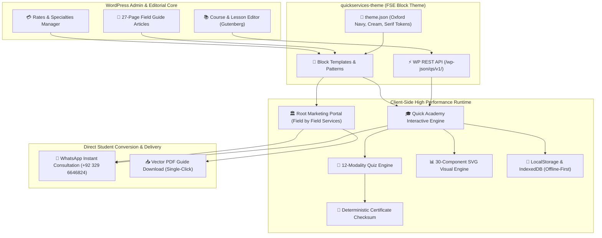

# Design Specification: Quick Services & Academy — Complete WordPress Transformation & Visual Redesign

*   **Author:** M. Yousaf / Quick Services Architecture Team
*   **Status:** APPROVED
*   **Date:** 2026-11-04
*   **Target Subsystem:** `quick-services-site/wordpress/quickservices-theme`

--------------------------------------------------------------------------------

## Overview

Quick Services is an academic consulting and research coaching firm led by M. Yousaf (MS English, Bahauddin Zakariya University). The platform provides postgraduate researchers (MPhil, MS, PhD) with thesis coaching, research methodology design, statistical analysis support (SPSS, SmartPLS, AMOS), APA 7th academic editing, and viva defense preparation. It also hosts the **Research Student's Field Guide** (a free 27-page open guide) and **Quick Academy** (an educational platform featuring 12 interactive assessment modalities, 30 semantic SVG visualization engines, and deterministic verification).

This document establishes the approved architectural and visual specification for transforming the complete Quick Services platform into an enterprise-grade, high-performance **WordPress** Full Site Editing (FSE) block theme (`quickservices-theme`) with an elevated **Oxford Academic Editorial** visual design language.

--------------------------------------------------------------------------------

## The Problem

1. **Aesthetic & Brand Mismatch**:
   The existing website relies on a dark navy (`#0a0f1c`) and neon orange (`#ff6b2c`) color scheme with monospace tech styling. This aesthetic resembles a developer SaaS tool or crypto portal rather than an elite, prestigious academic consultancy and scholarly academy. Postgraduate scholars, faculty, and research candidates seek academic rigor, quiet competence, editorial dignity, and trust.

2. **Static Maintenance Bottleneck**:
   All marketing pages, service rates, testimonials, and Academy course curricula are hardcoded across static `.html` and `.json` files. Updating rates, publishing new student reviews, expanding the Field Guide, or launching new masterclasses requires developer code modification rather than dynamic CMS management via WordPress.

3. **Academy Subsystem Disconnect**:
   The Quick Academy currently runs as a standalone client-side Single Page Application (SPA). While technically fast and offline-capable, it is completely detached from a unified content management backend. Non-technical staff cannot draft new modules, inspect student engagement, or publish interactive quiz scenarios through standard WordPress editorial workflows.

4. **WordPress Compatibility Gap**:
   There is no WordPress theme, template structure, or block library currently available for Quick Services. Attempting to deploy traditional WordPress page builders (such as Elementor or Divi) would degrade performance, introduce massive script bloat, break offline capabilities, and violate the platform's strict lightweight standards.

--------------------------------------------------------------------------------

## Goals

1. **Bespoke WordPress Block Theme (FSE)**:
   Deliver a clean, lightweight, modern WordPress Full Site Editing (FSE) block theme (`quickservices-theme`) that conforms to standard WordPress Block API and Theme.json specifications without requiring third-party builder plugins.

2. **Dignified & Distinctive Visual Identity**:
   Replace the generic tech-dark theme with a high-credibility academic editorial visual system:
   - Refined typography pairing: Classical high-contrast editorial serif headers (e.g. *Fraunces* or *Playfair Display*) paired with clean geometric modern sans body (*Plus Jakarta Sans* / *Inter*).
   - Scholarly, authoritative palette: Deep Oxford Blue (`#0F1E36`) / Scholarly Forest (`#112A24`), warm ivory and cream backgrounds (`#FAF8F5` / `#F3EFE6`), rich bronze/ochre accents (`#C88A35`), and crisp borders.
   - Micro-interactions: Subtle card elevation, smooth accordion transitions, and clean tabular comparison layouts.

3. **Integrated Quick Academy LMS Architecture**:
   Provide a native WordPress implementation for Quick Academy that retains all 12 assessment modalities (`match`, `categorise`, `hotspot`, `shortAnswer`, `scenario`, `calculation`, etc.) and 30 SVG visual engines, with support for WordPress Custom Post Types (`qs_course`, `qs_lesson`, `qs_quiz`) or a unified dynamic block mount.

4. **Preserve High Performance & Ethics**:
   - Zero-bloat guarantee: Sub-1-second LCP, minimal external JavaScript, native SVG icons.
   - Maintain the core academic ethics pledge: Coaching and editing only; zero ghostwriting or academic cheating assistance.
   - Full mobile responsiveness across 360px to 4K viewports with WCAG 2.1 AA accessibility.

--------------------------------------------------------------------------------

## Non-Goals

1. **No Commercial Builder Bloat**:
   We will not use Elementor, Divi, Beaver Builder, or WPBakery. The architecture will rely strictly on native WordPress Gutenberg blocks, theme.json, and lightweight custom Web Components.

2. **No Backend Database Lock for Quizzes**:
   The interactive quizzes and visualizers must remain executable client-side with zero mandatory server round-trips for each question click, preserving instantaneous responsiveness.

3. **No Plagiarism / Cheating Services**:
   The platform will never offer ghostwriting, exam-taking, or plagiarism evasion services. All branding and copy must reinforce ethical academic assistance.

--------------------------------------------------------------------------------

## Technical Plan

### 1. WordPress Theme Architecture & File Manifest

The theme is architected as an FSE Block Theme under `wp-content/themes/quickservices-theme/`:

```text
quickservices-theme/
├── style.css                                # Theme metadata declaration & base resets
├── theme.json                               # Global design tokens, typography, spacing & layout presets
├── functions.php                            # CPT registrations, asset enqueueing, REST endpoints
├── index.php                                # Fallback template required by WordPress
├── templates/
│   ├── index.html                           # Fallback query loop template
│   ├── front-page.html                      # Primary landing page block template
│   ├── page-field-guide.html                # 27-Page Research Student's Field Guide template
│   ├── page-academy.html                    # Quick Academy hub and catalog template
│   ├── single-qs_course.html                # Course syllabus & overview template
│   ├── single-qs_lesson.html                # Interactive classroom lesson template
│   └── 404.html                             # Academic 404 error page with quick links
├── parts/
│   ├── header.html                          # Sticky responsive navigation with WhatsApp quick-action
│   ├── footer.html                          # Editorial footer, ethical pledge, credentials & contact
│   ├── trust-strip.html                     # Metrics strip (60+ theses coached, BZU MS credential, etc.)
│   └── inquiry-modal.html                   # Rapid WhatsApp & Email consultation launcher
├── patterns/
│   ├── hero-editorial.php                   # Split hero with serif display typography & field guide badge
│   ├── specialties-grid.php                 # Academic editing, SPSS/SmartPLS, literature search, viva
│   ├── pricing-matrix.php                   # Clear tier cards (PKR / USD / GBP toggles)
│   ├── field-guide-preview.php              # Chapter synopsis cards & direct PDF download triggers
│   └── academy-course-card.php              # Dynamic course card with progress ring & lesson count
└── assets/
    ├── css/
    │   ├── theme-editorial.css              # Custom layout enhancements, typography rhythm & animations
    │   └── academy-engines.css              # Quiz modalities (12 types) and visual diagram styling
    ├── js/
    │   ├── theme-interactions.js            # Header scroll, mobile drawer, modal triggers
    │   └── academy/
    │       ├── quiz-engine.js               # Standalone 12-modality client-side quiz runner
    │       ├── visual-engine.js             # SVG/HTML 30-component visual diagram renderer
    │       ├── cert-engine.js               # Verifiable cryptographic checksum certificate generator
    │       └── state-store.js               # LocalStorage & IndexedDB offline-first synchronization
    └── images/
        ├── brand-crest.svg                  # Refined academic crest / monogram
        └── textures/                        # Subtle noise/parchment background SVG textures
```

### 2. Design System Tokens (`theme.json`)

```json
{
  "$schema": "https://schemas.wp.org/trunk/theme.json",
  "version": 3,
  "settings": {
    "color": {
      "palette": [
        { "slug": "oxford-navy", "color": "#0C192E", "name": "Oxford Navy" },
        { "slug": "hunter-forest", "color": "#16302B", "name": "Hunter Forest" },
        { "slug": "antique-bronze", "color": "#B8823B", "name": "Antique Bronze" },
        { "slug": "ivory-canvas", "color": "#FAF8F5", "name": "Ivory Canvas" },
        { "slug": "parchment-subtle", "color": "#F3EFE6", "name": "Parchment Subtle" },
        { "slug": "ink-primary", "color": "#1A202C", "name": "Ink Primary" },
        { "slug": "slate-muted", "color": "#5A6A80", "name": "Slate Muted" },
        { "slug": "border-warm", "color": "#E5DFD3", "name": "Border Warm" }
      ]
    },
    "typography": {
      "fontFamilies": [
        {
          "fontFamily": "'Fraunces', 'Playfair Display', Georgia, serif",
          "slug": "serif-display",
          "name": "Editorial Serif"
        },
        {
          "fontFamily": "'Plus Jakarta Sans', system-ui, -apple-system, sans-serif",
          "slug": "sans-body",
          "name": "Modern Sans"
        },
        {
          "fontFamily": "'JetBrains Mono', monospace",
          "slug": "mono-code",
          "name": "Academic Monospace"
        }
      ],
      "fluid": true
    },
    "spacing": {
      "spacingScale": { "steps": 0 },
      "units": ["px", "em", "rem", "vh", "vw", "%"]
    }
  }
}
```

### 3. Quick Academy WordPress Integration Pipeline

The Quick Academy content model is implemented natively in WordPress:

1. **Custom Post Types (CPT)**:
   - `qs_course`: Masterclass units (e.g., *SPSS & SmartPLS Mastery*, *APA 7th Dissertation Defense*, *Turnitin Remediation*).
   - `qs_lesson`: Discrete learning modules under each course. Contains custom Gutenberg blocks for lesson text, inline visual diagrams, and embedded quiz checkpoints.
2. **Metadata & Dynamic Attributes**:
   - Course metadata (`_qs_duration_min`, `_qs_badge_id`, `_qs_level`).
   - Lesson schema (`_qs_visual_config`, `_qs_quiz_config`).
3. **Execution Runtime**:
   The frontend renders lessons using the zero-build client-side engines:
   - Lessons read JSON configuration generated directly from WordPress block attributes.
   - Interactive quizzes run without page reloads.
   - Deterministic certificate generation runs on completion:
     $$\text{ID} = \text{QSA-}[\text{COURSE}]-[\text{TIMESTAMP}]-[\text{CRC32}(\text{Student} + \text{Score} + \text{Date})]$$

### 4. Architecture & Data Flow Diagram



--------------------------------------------------------------------------------

## Alternatives Considered

### 1. Commercial Page Builders (Elementor Pro / Divi / WPBakery)
*   **Mechanism**: Designing the site using visual drag-and-drop page builders.
*   **Why Rejected**:
    - Generates 1.5 MB to 3.5 MB of bloated, render-blocking CSS and JS assets, causing severe Core Web Vitals degradation (failing LCP and INP standards).
    - Enforces proprietary data locking that breaks native WordPress export and clean templating.
    - Fails to support offline-first execution and conflicts with custom Web Components and pure SVG rendering required by Quick Academy.

### 2. Off-The-Shelf Commercial LMS Plugins (LearnDash / Tutor LMS / LifterLMS)
*   **Mechanism**: Adopting a third-party WordPress LMS plugin for course delivery and assessments.
*   **Why Rejected**:
    - Generic commercial LMS plugins enforce rigid server-side PHP form posting for quizzes, introducing noticeable latency for students on mobile networks.
    - Completely lacks support for Quick Academy's specialized 12 assessment modalities (such as SVG interactive `hotspot` tapping, drag-and-drop `categorise`, and mathematical `calculation` with precision tolerance bands).
    - Imposes steep recurring licensing fees ($199–$399/year) without solving the core need for custom academic diagramming engines.

### 3. Headless Decoupled Architecture (Next.js + WP REST API)
*   **Mechanism**: Building a React/Next.js frontend hosted on Vercel/Cloudflare that fetches content from a headless WordPress backend.
*   **Why Rejected**:
    - Requires managing two independent hosting environments and deployment pipelines, creating unnecessary operational overhead and cost for a small consulting practice.
    - Prevents site administrators from previewing live layout and style modifications directly inside the standard WordPress visual Site Editor.

### 4. Retaining Pure Static Hosting on Cloudflare Pages
*   **Mechanism**: Maintaining the current workflow of hand-editing static HTML, CSS, and JSON files on GitHub Pages / Cloudflare Pages.
*   **Why Rejected**:
    - Directly violates the user's explicit objective: to have a maintainable, modern platform suitable for WordPress that enables rapid content updates, dynamic testimonials, rate adjustments, and new course publications without code deployments.

--------------------------------------------------------------------------------

## Detailed Implementation Plan

### 1. Master Implementation Sequence

1.  **Phase 1: WordPress Theme Scaffolding & Design System Tokens**
    *   Construct the complete directory hierarchy under `quickservices-theme/`.
    *   Define `style.css` with required WordPress theme header metadata.
    *   Author `theme.json` containing the Oxford Academic Editorial design system:
        *   Palette: Oxford Navy (`#0C192E`), Scholarly Forest (`#16302B`), Antique Bronze (`#B8823B`), Ivory Canvas (`#FAF8F5`), Parchment (`#F3EFE6`).
        *   Typography: Fraunces / Playfair Display paired with Plus Jakarta Sans and JetBrains Mono.
        *   Spacing scales and responsive layout constraints (1200px container width).
    *   Author `functions.php`:
        *   Register custom post types: `qs_course` and `qs_lesson`.
        *   Enqueue theme assets conditionally (load academy scripts only on academy and lesson routes).
        *   Register custom block pattern categories (`quickservices/marketing`, `quickservices/academy`).

2.  **Phase 2: Block Templates & Template Parts**
    *   Author `templates/front-page.html`:
        *   Editorial header block part (`parts/header.html`).
        *   Hero block pattern (`patterns/hero-editorial.php`) with headline, crediting M. Yousaf (MS English, BZU), and WhatsApp primary CTA.
        *   Scholarly trust bar (`parts/trust-strip.html`) displaying 60+ projects, 3+ years experience, and zero-plagiarism pledge.
        *   Field-by-field specialties block pattern (`patterns/specialties-grid.php`).
        *   27-Page Research Student's Field Guide callout with live chapter preview (`patterns/field-guide-preview.php`).
        *   Tiered transparent pricing matrix pattern (`patterns/pricing-matrix.php`) with PKR / USD / GBP currency toggle.
        *   Editorial footer block part (`parts/footer.html`) with academic ethics statement and verified credentials.
    *   Author `templates/page-field-guide.html`:
        *   Complete 27-chapter reading layout with sticky sidebar table of contents and direct PDF download trigger.
    *   Author `templates/404.html`:
        *   Custom branded error page directing scholars back to consulting services or the Field Guide.

3.  **Phase 3: Quick Academy Subsystem WordPress Integration**
    *   Author `templates/page-academy.html`:
        *   Academy curriculum catalog querying `qs_course` posts.
        *   Dynamic course cards with module counts, estimated duration, and offline progress indicators.
        *   Certificate verification search bar allowing third-party institutions to validate student certificate IDs.
    *   Author `templates/single-qs_course.html`:
        *   Syllabus hierarchy, prerequisites, learning outcomes, and "Start Masterclass" CTA.
    *   Author `templates/single-qs_lesson.html`:
        *   Classroom reading view with progress bar.
        *   Interactive diagram mount root (`#visual-container`) managed by `visual-engine.js`.
        *   Interactive assessment checkpoint mount root (`#quiz-container`) managed by `quiz-engine.js`.
        *   Lesson completion trigger updating student progress in `localStorage` and issuing certificate upon reaching 100%.

4.  **Phase 4: Client-Side Interactive Engine Migration**
    *   Port and package `assets/js/academy/quiz-engine.js`:
        *   Complete implementation of all 12 assessment modalities (`multipleChoice`, `trueFalse`, `reorder`, `fillBlank`, `selectGroup`, `likert`, `match`, `categorise`, `hotspot`, `shortAnswer`, `scenario`, `calculation`).
        *   Ensure zero dependency on external frameworks; pure ES6 modular JavaScript.
    *   Port and package `assets/js/academy/visual-engine.js`:
        *   Complete implementation of all 30 semantic HTML5 / inline-SVG visual renderers (`venn`, `pyramid`, `numberLine`, `barchart`, `donut`, `mindmap`, `iconCards`, `keyTermCard`, `table`, `anatomy`, etc.).
    *   Port and package `assets/js/academy/cert-engine.js`:
        *   Cryptographic polynomial checksum generator (DJB2/CRC32) producing verifiable IDs: `QSA-{COURSE}-{TIMESTAMP}-{CHECKSUM}`.
    *   Port and package `assets/js/academy/state-store.js`:
        *   Offline-first storage manager syncing course progress between `localStorage` and `IndexedDB`.

5.  **Phase 5: Styling & Polish**
    *   Author `assets/css/theme-editorial.css`:
        *   Micro-interactions, card elevation shadows, smooth focus rings, and responsive tables.
    *   Author `assets/css/academy-engines.css`:
        *   Touch-friendly drag targets (min 48px), accessible SVG hotspot rings, and interactive feedback banners.
    *   Author `assets/js/theme-interactions.js`:
        *   Sticky header transition on scroll, mobile navigation drawer, and WhatsApp inquiry modal trigger.

6.  **Phase 6: Verification & Quality Assurance**
    *   Execute static syntax checks on all PHP, JSON, and JavaScript files.
    *   Validate HTML semantic structure and WCAG 2.1 AA color contrast ratios (minimum 4.5:1 for body copy).
    *   Verify all 12 quiz modalities through simulated question payloads.
    *   Verify all 30 visual diagram types render without console errors.
    *   Verify deterministic certificate generation and reverse validation.

---

### 2. Complete File Touch List & Rationales

| File Path | Action | Rationale |
|---|---|---|
| `wp-content/themes/quickservices-theme/style.css` | **[NEW]** | Declares WordPress theme metadata, theme name, version, author, and base resets. |
| `wp-content/themes/quickservices-theme/theme.json` | **[NEW]** | Establishes the Oxford Academic Editorial design system tokens (colors, serif/sans fonts, fluid font scales, spacing presets). |
| `wp-content/themes/quickservices-theme/functions.php` | **[NEW]** | Registers Custom Post Types (`qs_course`, `qs_lesson`), pattern categories, conditional asset enqueues, and REST routes. |
| `wp-content/themes/quickservices-theme/index.php` | **[NEW]** | Mandatory fallback template file required by WordPress theme standard specification. |
| `wp-content/themes/quickservices-theme/templates/index.html` | **[NEW]** | Generic query loop template for standard WordPress archive/blog views. |
| `wp-content/themes/quickservices-theme/templates/front-page.html` | **[NEW]** | Primary landing page FSE block template displaying hero, trust strip, specialties, field guide, pricing, and contact. |
| `wp-content/themes/quickservices-theme/templates/page-field-guide.html` | **[NEW]** | Full 27-chapter reading layout for the Research Student's Field Guide with sticky TOC and PDF download. |
| `wp-content/themes/quickservices-theme/templates/page-academy.html` | **[NEW]** | Quick Academy hub template displaying course catalog, progress summary, and certificate verification. |
| `wp-content/themes/quickservices-theme/templates/single-qs_course.html` | **[NEW]** | Course overview and masterclass syllabus breakdown template. |
| `wp-content/themes/quickservices-theme/templates/single-qs_lesson.html` | **[NEW]** | Interactive classroom template hosting lesson text, SVG diagrams, and quiz assessment checkpoints. |
| `wp-content/themes/quickservices-theme/templates/404.html` | **[NEW]** | Branded academic 404 page providing recovery navigation to consulting services and the Field Guide. |
| `wp-content/themes/quickservices-theme/parts/header.html` | **[NEW]** | Sticky responsive header template part with brand crest, navigation links, and WhatsApp CTA. |
| `wp-content/themes/quickservices-theme/parts/footer.html` | **[NEW]** | Editorial footer template part with ethical academic pledge, university credentials, and contact channels. |
| `wp-content/themes/quickservices-theme/parts/trust-strip.html` | **[NEW]** | Reusable trust strip highlighting 60+ projects, BZU MS credential, and zero-plagiarism policy. |
| `wp-content/themes/quickservices-theme/parts/inquiry-modal.html` | **[NEW]** | Rapid consultation modal allowing visitors to launch WhatsApp inquiries with pre-filled service scopes. |
| `wp-content/themes/quickservices-theme/patterns/hero-editorial.php` | **[NEW]** | Gutenberg block pattern for high-impact editorial hero with typography pairing and credibility badge. |
| `wp-content/themes/quickservices-theme/patterns/specialties-grid.php` | **[NEW]** | Gutenberg block pattern for 6 academic consulting disciplines with problem-solution framing. |
| `wp-content/themes/quickservices-theme/patterns/pricing-matrix.php` | **[NEW]** | Gutenberg block pattern for transparent tiered pricing with multi-currency switch (PKR, USD, GBP). |
| `wp-content/themes/quickservices-theme/patterns/field-guide-preview.php` | **[NEW]** | Gutenberg block pattern for 27-page guide synopsis cards and vector PDF download triggers. |
| `wp-content/themes/quickservices-theme/patterns/academy-course-card.php` | **[NEW]** | Gutenberg block pattern for dynamic course display with progress indicators. |
| `wp-content/themes/quickservices-theme/assets/css/theme-editorial.css` | **[NEW]** | Custom editorial layout styling, fluid typography, subtle card borders, and smooth transitions. |
| `wp-content/themes/quickservices-theme/assets/css/academy-engines.css` | **[NEW]** | Styling for all 12 quiz question modalities, accessible SVG hotspots, and interactive feedback cards. |
| `wp-content/themes/quickservices-theme/assets/js/theme-interactions.js` | **[NEW]** | Lightweight vanilla JS for header stickiness, mobile navigation drawer, and inquiry modal controls. |
| `wp-content/themes/quickservices-theme/assets/js/academy/quiz-engine.js` | **[NEW]** | Pure ES6 client-side quiz engine executing all 12 assessment modalities without page refreshes. |
| `wp-content/themes/quickservices-theme/assets/js/academy/visual-engine.js` | **[NEW]** | Pure ES6 visual engine rendering all 30 semantic HTML5/inline-SVG diagrams. |
| `wp-content/themes/quickservices-theme/assets/js/academy/cert-engine.js` | **[NEW]** | Deterministic polynomial checksum algorithm issuing verifiable certificate IDs. |
| `wp-content/themes/quickservices-theme/assets/js/academy/state-store.js` | **[NEW]** | Offline-first storage manager syncing student progress with LocalStorage and IndexedDB. |
| `wp-content/themes/quickservices-theme/assets/images/brand-crest.svg` | **[NEW]** | Vector Oxford academic emblem and monogram for Quick Services. |
| `C:\Users\Huzaifa Mahi\quick-services-site\README.md` | **[MODIFY]** | Updates project documentation to describe both the static site and the WordPress FSE theme package. |
| `C:\Users\Huzaifa Mahi\quick-services-site\AGENTS.md` | **[MODIFY]** | Updates architectural subsystem boundaries and documentation references for the WordPress theme. |
